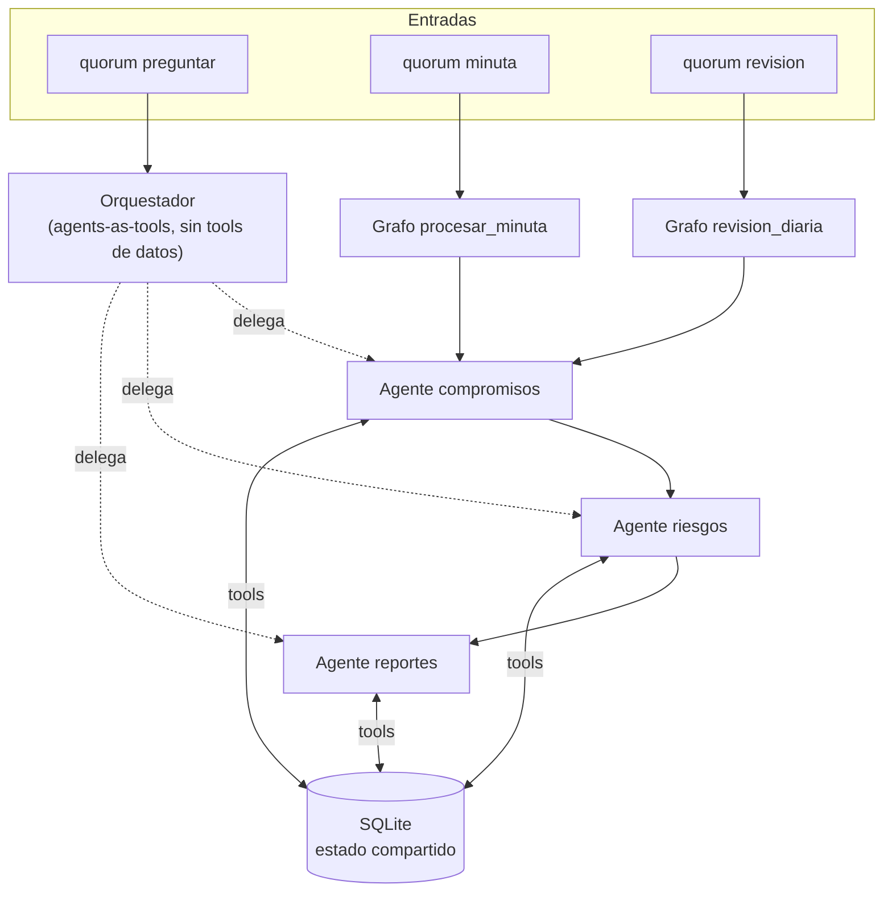

# quorum [IN PROGRESS]

Framework multiagente de gestión de proyectos construido con [Strands Agents SDK](https://strandsagents.com) y modelos gratuitos de [OpenRouter](https://openrouter.ai).

Tres agentes especialistas (**compromisos**, **riesgos** y **reportes**) coordinados por un orquestador comparten un único estado del proyecto en SQLite. Ningún especialista llama a otro: se coordinan porque leen lo que los otros escribieron en el estado compartido.

> Proyecto en desarrollo por fases. Ver [Estado](#estado) para saber qué está disponible hoy.

---

## Índice

- [Qué resuelve](#qué-resuelve)
- [Estado](#estado)
- [Inicio rápido](#inicio-rápido)
- [Uso de la CLI](#uso-de-la-cli)
- [Arquitectura](#arquitectura)
- [Modelo de datos](#modelo-de-datos)
- [Agentes y tools](#agentes-y-tools)
- [Cupo del plan gratuito](#cupo-del-plan-gratuito)
- [Tests y evaluaciones](#tests-y-evaluaciones)
- [Estructura del repositorio](#estructura-del-repositorio)
- [Decisiones de diseño](#decisiones-de-diseño)

---

## Qué resuelve

| Comando | Qué hace | Estado |
|---|---|---|
| `minuta` | Recibe el texto de una reunión, extrae los compromisos (qué, quién, para cuándo), evalúa riesgos nuevos y devuelve un resumen de cambios. | Extracción de compromisos ✅ · riesgos y resumen en Fase 4 |
| `revision` | Marca compromisos vencidos, recalcula riesgos y genera alertas. | Fase 7 |
| `preguntar` | Preguntas en lenguaje natural (“¿qué está atrasado?”, “armame el estado semanal”). El orquestador delega en el especialista adecuado. | Fase 6 |
| `reporte` | Genera el reporte semanal o ejecutivo en markdown. | Fase 5 |

Fuera de alcance en la v1: integraciones externas (Jira, Slack, email), interfaz web y envío automático de mensajes.

## Estado

| Fase | Contenido | Criterio de aceptación | Estado |
|---|---|---|---|
| 1. Base | `models.py`, `store.py`, tools sin LLM | pytest en verde; cada escritura genera un Evento | ✅ |
| 2. Conexión | `llm.py` + agente de prueba | un agente `:free` llama a una tool; el fallback se activa al forzar un error | ✅ |
| 3. Compromisos | `agente_compromisos` + comando `minuta` | ≥ 80 % de compromisos extraídos en 3 minutas, sin inventar responsables | ✅ 88 % (14/16), 0 inventados |
| 4. Riesgos | `agente_riesgos` + grafo `procesar_minuta` | un compromiso vencido genera o actualiza un riesgo; sin duplicados | ⏳ |
| 5. Reportes | `agente_reportes` + comando `reporte` | el reporte solo cita datos existentes en la base | ⏳ |
| 6. Orquestador | `orquestador.py` + comando `preguntar` | enruta bien 9 de 10 preguntas | ⏳ |
| 7. Revisión diaria | grafo `revision_diaria` | menos de 15 solicitudes; deja alertas como Reporte tipo `alerta` | ⏳ |

## Inicio rápido

Requisitos: Python 3.11 o superior y una API key de OpenRouter.

```bash
git clone https://github.com/fransempe/quorum-aiday.git
cd quorum-aiday

python -m venv .venv
# Windows
.venv\Scripts\python -m pip install -e ".[dev]"
# Linux / macOS
.venv/bin/python -m pip install -e ".[dev]"

cp .env.example .env   # y completar OPENROUTER_API_KEY
```

`.env`:

```ini
OPENROUTER_API_KEY=sk-or-...
MODEL_ORCHESTRATOR=nvidia/nemotron-3-ultra-550b-a55b:free
MODEL_SPECIALIST=nvidia/nemotron-3-super-120b-a12b:free
MODEL_FALLBACK=openrouter/free
DB_PATH=data/proyecto.db
MAX_REQUESTS_PER_RUN=15
```

Los IDs de modelo se leen siempre del entorno; no hay ninguno escrito en el código.

No hace falta activar el entorno virtual si se usa la ruta completa (`.venv\Scripts\quorum`). Si se activa (`.venv\Scripts\Activate.ps1` en PowerShell, `source .venv/bin/activate` en bash), alcanza con `quorum`.

## Uso de la CLI

```bash
quorum --help

# Procesar una minuta (el id de origen es el nombre del archivo)
quorum minuta data/minutas_ejemplo/minuta-01.md

# Con un id de origen explícito
quorum minuta mi-reunion.md --origen reunion-2026-10-09

# Desde la entrada estándar
cat mi-reunion.md | quorum minuta - --origen reunion-2026-10-09
```

Salida de ejemplo (ilustrativa; la respuesta del agente varía entre corridas):

```text
Procesando minuta 'minuta-01'...

Creé 5 compromisos a partir de la minuta.

Cambios registrados (5):
  + C-001 Entregar la maqueta navegable de la pantalla de reservas (Carla, 2026-10-12)
  + C-002 Documentar el modelo de datos de salas y reservas (Bruno, 2026-10-09)
  + C-003 Configurar el entorno de pruebas (Bruno, sin fecha)
  + C-004 Redactar el plan de pruebas de la primera versión (Diego, 2026-10-16)
  + C-005 Enviar a la biblioteca el cronograma actualizado (Ana, 2026-10-07)
Solicitudes al modelo: 7/15
```

El bloque **Cambios registrados** no lo redacta el modelo: sale de la bitácora de eventos de la base, así que refleja exactamente lo que quedó guardado. Si el flujo se corta (por cupo o por error del modelo), igual se muestra lo que alcanzó a guardarse y el comando sale con código 1.

Los datos quedan en `data/proyecto.db` (SQLite). Para empezar de cero, borrar ese archivo.

## Arquitectura



- **Preguntas libres** → orquestador con patrón *agents-as-tools*: cada especialista es una función `@tool` que crea y llama a un `Agent`. El orquestador no tiene tools de datos; solo delega.
- **Minuta y revisión diaria** → grafo fijo con `strands.multiagent.GraphBuilder`: compromisos → riesgos → reportes. No se usa `Swarm` porque consume más solicitudes.
- **Estado compartido** en SQLite. Los agentes leen y escriben solo a través de tools. Toda escritura se valida con Pydantic y registra un `Evento` en la misma transacción.

### Conexión a OpenRouter

Strands no tiene proveedor propio de OpenRouter, así que se usa `OpenAIModel` apuntando a `https://openrouter.ai/api/v1` con `temperature=0.2` y `max_tokens=2000`. `crear_modelo(model_id)` en [`pm_agents/llm.py`](pm_agents/llm.py) devuelve un `ModeloOpenRouter`, subclase de `OpenAIModel` que agrega el control de cupo, el reintento y el modelo de respaldo.

## Modelo de datos

| Entidad | Campos | Reglas |
|---|---|---|
| **Compromiso** | id, descripcion, responsable, fecha_limite, estado, origen, creado_en | estado ∈ {pendiente, cumplido, vencido, cancelado}; descripción de 5 caracteres o más; responsable y fecha pueden quedar vacíos (no se inventan) |
| **Riesgo** | id, titulo, descripcion, probabilidad (1–5), impacto (1–5), severidad, mitigacion, compromisos_relacionados, estado | severidad = probabilidad × impacto (calculada, nunca se carga a mano); estado ∈ {abierto, mitigado, cerrado} |
| **Evento** | id, tipo, payload (JSON), agente, creado_en | bitácora de todo cambio |
| **Reporte** | id, tipo, periodo, contenido (markdown), creado_en | tipo ∈ {semanal, ejecutivo, alerta} |

Tipos de evento: `compromiso.creado`, `compromiso.actualizado`, `compromiso.vencido`, `riesgo.creado`, `riesgo.actualizado`, `reporte.generado`.

Los IDs son legibles para que el modelo los pueda citar: `C-001`, `R-001`, `REP-001`, `E-001`. Las actualizaciones guardan en el evento el antes y el después de cada campo cambiado:

```json
{"id": "R-001", "cambios": {"probabilidad": {"antes": 2, "despues": 5}, "severidad": {"antes": 6, "despues": 15}}}
```

Reglas de integridad que aplica el store, además de la validación de Pydantic:

- No se crea un compromiso con la misma descripción y responsable que otro no cancelado (ignora mayúsculas y espacios).
- No se registra un riesgo **abierto** con el mismo título que otro abierto; el error le indica al agente que lo actualice.
- `compromisos_relacionados` debe apuntar a compromisos existentes.
- Una actualización sin cambios reales se rechaza, para no ensuciar la bitácora.
- Si una escritura falla, no queda ni el dato ni el evento.

## Agentes y tools

| Agente | Tools | Modelo |
|---|---|---|
| Orquestador | `agente_compromisos`, `agente_riesgos`, `agente_reportes` | `MODEL_ORCHESTRATOR` |
| Compromisos | `listar_compromisos`, `crear_compromiso`, `actualizar_compromiso`, `marcar_vencidos` | `MODEL_SPECIALIST` |
| Riesgos | `listar_compromisos`, `listar_riesgos`, `registrar_riesgo`, `actualizar_riesgo` | `MODEL_SPECIALIST` |
| Reportes | `listar_compromisos`, `listar_riesgos`, `listar_eventos`, `guardar_reporte` | `MODEL_SPECIALIST` |

Máximo 5 tools por agente. Los prompts de sistema están en [`pm_agents/agents/prompts.py`](pm_agents/agents/prompts.py).

Las tools devuelven JSON compacto. Ante un error de validación o de negocio devuelven un texto `Error: ...` en lugar de lanzar una excepción, para que el agente pueda corregir el pedido sin cortar el flujo. Cada tool de escritura registra en el evento qué agente hizo el cambio.

## Cupo del plan gratuito

Los modelos `:free` de OpenRouter permiten 20 solicitudes por minuto y 50 por día (1.000 por día si la cuenta compró al menos 10 USD de créditos). El diseño los respeta así:

- **Tope por ejecución**: cada comando arranca un contador nuevo. Cada solicitud al modelo, incluidos los reintentos fallidos, descuenta del cupo. Al llegar a `MAX_REQUESTS_PER_RUN` (15 por defecto) se lanza `CupoExcedido` y el flujo se corta.
- **Reintento y respaldo**: ante un 429 o un error del modelo hay un único reintento con backoff exponencial y después se cambia a `MODEL_FALLBACK`. En el peor caso son 3 solicitudes por llamada.
- **Modelo caído**: si el primario agota sus intentos, queda marcado durante el resto de la ejecución y los agentes siguientes van directo al respaldo.
- **Sin reintentos ocultos**: se desactivan los reintentos propios de Strands (hasta 6 ante un 429) y del cliente de OpenAI (`max_retries=0`). Un test verifica que, con todo fallando, se hacen exactamente 3 solicitudes.

## Tests y evaluaciones

```bash
# Tests sin modelo: no consumen cupo
pytest -q

# Tests contra OpenRouter real (marca llm): consumen cupo
pytest -m llm -s

# Solo el eval de extracción de compromisos (~24 solicitudes)
pytest -m llm -s tests/evals/test_eval_compromisos.py
```

- El store y las tools se testean sin LLM: las funciones decoradas con `@tool` se pueden llamar directamente.
- La lógica de reintento y respaldo se testea sin red, reemplazando el stream del modelo por uno simulado (429, errores de conexión, llamadas a tools).
- Los tests que usan el modelo llevan `@pytest.mark.llm` y no corren por defecto, para cuidar el cupo diario.

### Eval de extracción de compromisos

[`data/minutas_ejemplo/`](data/minutas_ejemplo/) tiene tres minutas de un proyecto ficticio (una app de reservas de salas para una biblioteca inventada), con ruido a propósito: decisiones que no son compromisos, comentarios sueltos y tareas sin responsable o sin fecha. Para cada una, [`tests/evals/`](tests/evals/) tiene un JSON con los compromisos esperados.

El evaluador busca cada compromiso esperado por palabras clave (sin distinguir tildes; cada término acepta alternativas separadas por `|`) y cuenta como **responsable inventado**:

- un responsable que no aparece en la minuta, o
- un responsable asignado a una tarea que la minuta deja sin dueño.

Último resultado: **14/16 (88 %)**, sin responsables inventados y con todas las fechas correctas. Los dos faltantes son tareas sin responsable asignado.

Los ejemplos no contienen datos reales: algunos proveedores gratuitos pueden usar las entradas para entrenar.

## Estructura del repositorio

```text
.
├── .env.example
├── pyproject.toml
├── pm_agents/
│   ├── config.py              # Settings (pydantic-settings) desde .env
│   ├── llm.py                 # crear_modelo(): OpenAIModel → OpenRouter, con cupo, reintento y respaldo
│   ├── models.py              # Compromiso, Riesgo, Evento, Reporte
│   ├── store.py               # Repositorio SQLite + registro de eventos
│   ├── tools/
│   │   ├── compromisos.py     # listar, crear, actualizar, marcar_vencidos
│   │   ├── riesgos.py         # listar, registrar, actualizar
│   │   └── reportes.py        # listar_eventos, guardar_reporte
│   ├── agents/
│   │   ├── prompts.py         # prompts de sistema y plantillas de pedidos
│   │   ├── especialistas.py   # agente_compromisos (riesgos y reportes en fases 4 y 5)
│   │   └── orquestador.py     # Fase 6
│   ├── flows.py               # procesar_minuta (grafo en Fase 4), revision_diaria (Fase 7)
│   └── cli.py                 # Typer: minuta (revision, preguntar, reporte en próximas fases)
├── data/minutas_ejemplo/      # 3 minutas ficticias
└── tests/
    ├── test_models.py, test_store.py, test_tools.py
    ├── test_llm.py            # reintento, respaldo y cupo, sin red
    ├── test_llm_conexion.py   # conexión real (marca llm)
    ├── test_fase3.py          # evaluador, especialista y CLI, sin red
    └── evals/                 # JSON esperados + eval de compromisos (marca llm)
```

## Decisiones de diseño

- **SQLite sin ORM.** El módulo estándar `sqlite3` alcanza. Hay una conexión compartida con lock, porque los nodos del grafo pueden correr en otros hilos.
- **El resumen de cambios sale de la bitácora**, no de la respuesta del modelo: lo que muestra la CLI es lo que efectivamente quedó guardado.
- **La severidad es un campo calculado.** No se puede cargar un valor inconsistente con probabilidad × impacto.
- **El control anti-duplicado está en el store y no solo en el prompt.** Evita solicitudes desperdiciadas y es determinista.
- **La fecha de hoy incluye el día de la semana** (“viernes 2026-10-09”), para que el agente resuelva fechas relativas como “el viernes”.
- **Aviso silenciado de Strands.** Nemotron devuelve razonamiento que la API de Chat Completions no acepta en turnos siguientes; Strands lo descarta y avisa en cada turno. La CLI oculta ese aviso, que es esperado, y deja visibles los propios (reintentos y cambio de modelo).

## Stack

Python 3.11+, `strands-agents[openai]`, pydantic v2, pydantic-settings, typer, pytest y SQLite.
